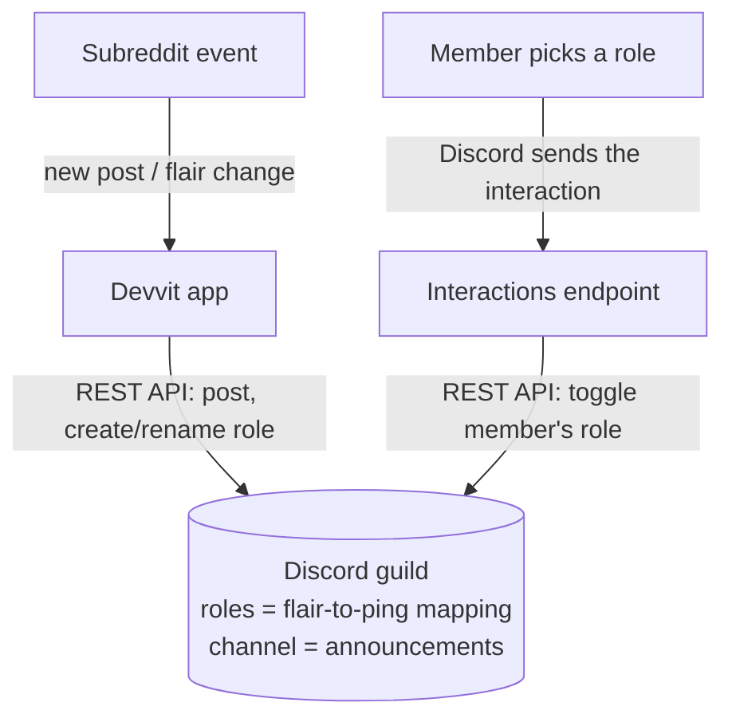

# Architecture

Two independent, stateless components talk to Discord's REST API; nothing but Discord's own guild roles holds the flair-to-notification mapping, so there's no database to run or keep in sync. The one piece of app state — the role-picker message's id — lives in Devvit's built-in per-install Redis, not a database of our own.

Reading note: a new post or a flair change on the subreddit drives the Devvit app, which calls Discord's bot REST API directly to post the embed, crosspost it, and create or rename roles as flairs change. A member picking a role button triggers Discord's own HTTPS interaction delivery to a separate, stateless endpoint, which calls that same REST API to toggle the role. The two paths never talk to each other directly — they only ever read and write the same guild.

## Components

### Devvit app (Reddit to Discord)

- Subscribes to Reddit's PostSubmit trigger inside Reddit's platform, and also runs a scheduled job every 15 minutes (`devvit.json`'s `scheduler.tasks`) — no server to host either way.
- Calls Discord's bot REST API over fetch (Devvit apps may make outbound HTTP to domains declared in `devvit.json`) to post the rich embed, crosspost it in the announcement channel, and create a role when a new flair appears.
- Looks up the Discord role ID to mention by querying the guild's current roles for a name match to the post's flair — no stored mapping to go stale. The match isn't the bare flair text: roles are named `alert:<slug>` (e.g. `alert:gpu`), so the flair text is slugified (lowercased, punctuation collapsed to hyphens) and prefixed before lookup. The role-picker's displayed label is still the bare flair text — only the underlying role name carries the prefix.
- The scheduled job lists the subreddit's current flair templates (there's no Reddit event for "a flair template changed," so this has to be a poll), ensures a role exists for each one, and PATCHes the pinned role-picker message's select-menu options to match — adding options for new flairs and pruning options for flairs that no longer exist. It never touches which roles a member already holds.
- The role-picker message itself is created and pinned by the app, not a moderator: the job reads the message id it last stored in Redis, and if there isn't one yet — or the stored message has been deleted — it posts and pins a new one in `discordPickerChannelId` and stores its id for next time.
- Holds the bot token as a Devvit secret.

### Interactions endpoint (Discord to member)

- A small stateless HTTPS function (not a persistent bot process) that Discord calls directly when a member uses the role-picker component — exactly the non-privileged, no-persistent-connection shape the spec calls for.
- Verifies the Ed25519 request signature, then calls Discord's bot REST API to add or remove the member's role.
- Reads the picker's options back from the select menu's own message components (whatever the Devvit app's scheduled job last wrote there) rather than querying the guild's roles live — it only ever needs to know what was offered, not the full role list.
- Needs its own copy of the bot token plus the application's public key, in whatever platform hosts it.

## Decisions

| Decision | Choice | Why |
| --- | --- | --- |
| Where the Interactions endpoint runs | Cloudflare Worker | Free tier, reliable, and fits the no-persistent-connection shape — confirmed over self-hosting on the VPS. |
| Self-service UX | A pinned select-menu message | No command to discover, and one message holds every flair role. |
| Keeping the picker's options in sync | Devvit app polls Reddit's flair-template list every 15 minutes and PATCHes the message | No Reddit event fires on flair-template changes; the message itself is the only thing that needs to stay current. |
| Who creates/owns the picker message | The Devvit app creates and pins it itself, keyed off a message id it persists in per-install Redis (recreating it if the message is deleted) | A moderator only has to pick a channel (`discordPickerChannelId`) — no manual API call to hand-craft the message with the right `custom_id`, and no message id to copy into settings. |
| Catch-all role delivery | Opt in explicitly, same as any flair role | Per spec: never pre-granted. |

See [Tech stack](tech-stack.md) for the concrete implementation choices (languages, libraries, CI).
