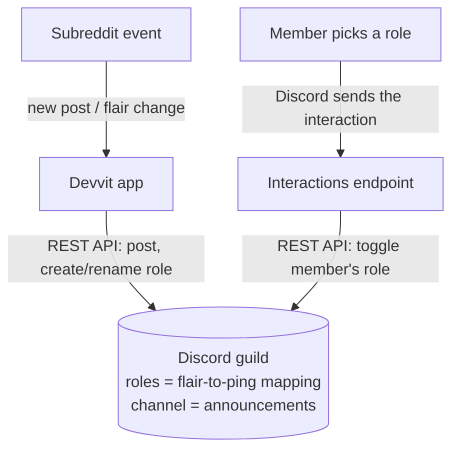

# Architecture

Two independent, stateless components talk to Discord's REST API; nothing but Discord's own guild roles holds the flair-to-notification mapping, so there's no database to run or keep in sync.

Reading note: a new post or a flair change on the subreddit drives the Devvit app, which calls Discord's bot REST API directly to post the embed, crosspost it, and create or rename roles as flairs change. A member picking a role button triggers Discord's own HTTPS interaction delivery to a separate, stateless endpoint, which calls that same REST API to toggle the role. The two paths never talk to each other directly — they only ever read and write the same guild.

## Components

### Devvit app (Reddit to Discord)

- Subscribes to Reddit's PostSubmit trigger (and a scheduled job or flair-change trigger) inside Reddit's platform — no server to host.
- Calls Discord's bot REST API over fetch (Devvit apps may make outbound HTTP to domains declared in `devvit.json`) to post the rich embed, crosspost it in the announcement channel, and create or rename a role when a new flair appears.
- Looks up the Discord role ID to mention by querying the guild's current roles for a name match to the post's flair — no stored mapping to go stale.
- Holds the bot token as a Devvit secret.

### Interactions endpoint (Discord to member)

- A small stateless HTTPS function (not a persistent bot process) that Discord calls directly when a member uses the role-picker component — exactly the non-privileged, no-persistent-connection shape the spec calls for.
- Verifies the Ed25519 request signature, then calls Discord's bot REST API to add or remove the member's role.
- Builds the picker's options by listing the guild's current roles live, so it never drifts from what the Devvit app created.
- Needs its own copy of the bot token plus the application's public key, in whatever platform hosts it.

## Decisions

| Decision | Choice | Why |
| --- | --- | --- |
| Where the Interactions endpoint runs | Cloudflare Worker | Free tier, reliable, and fits the no-persistent-connection shape — confirmed over self-hosting on the VPS. |
| Self-service UX | A pinned select-menu message | No command to discover, and one message holds every flair role. |
| Catch-all role delivery | Opt in explicitly, same as any flair role | Per spec: never pre-granted. |

See [Tech stack](tech-stack.md) for the concrete implementation choices (languages, libraries, CI).
