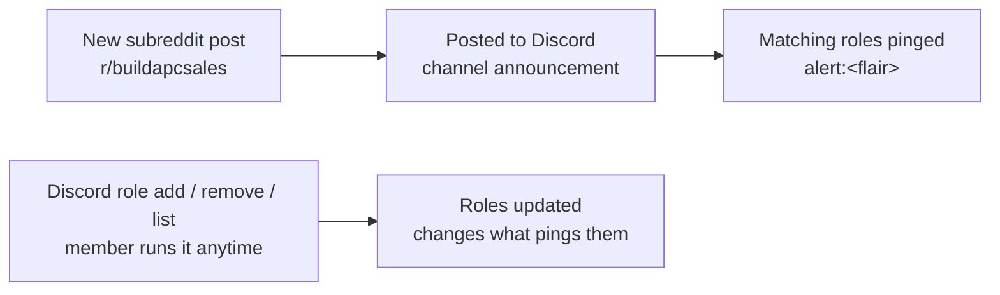

# Product spec

*As of 2026-11-26*

BAPCS Bot connects Discord to the larger r/buildapcsales reddit: new subreddit posts become Discord announcements, and members choose which categories of posts ping them.

## What it does

- **Post alerts** — every new subreddit submission is posted to a designated Discord channel: the title as plain message content (so it survives even where embeds are disabled), plus a rich, flair-colored embed with the title link, source domain, author, and a link to the comments.
- **Per-flair notifications** — a Discord role exists for each subreddit post flair; holding that role gets a member pinged whenever a matching post goes out. One catch-all role pings on every post and must be explicitly opted into.
- **Self-service role management** — members manage their own notification roles with no moderator involvement required.
- **Automatic role maintenance** — a background sync (every 4 hours) creates the matching Discord role for any new post flair and refreshes a local cache of flair -> role mappings; flair changes on Reddit never require manual role setup in Discord. Post alerts ping from that cache rather than asking Discord on every post, so a flair introduced between syncs goes out unpinged (catch-all still pings) until the next sync picks it up.
- **Auto-publish** — announcement messages are published so that other servers following this channel receive them automatically.

## How it fits together

The two flows don't depend on each other at the moment a member interacts with them: a post goes out to whoever already holds the matching role, and a role change only impacts which roles a member holds for next time.

## Platform foundations

These are implementation choices, kept here only for context. The Reddit side runs on Reddit's Developer Platform (Devvit), since Reddit is retiring the legacy API this bot used to depend on. The Discord side runs on non-privileged Discord permissions only — no elevated member-list or message-content access — using non-message Discord methods rather than a persistent bot connection.

See [Architecture](architecture.md) for the system design.
